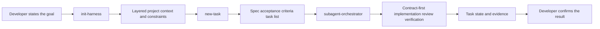

# Codex Harness Workflow

> An Agent Coding SOP that uses Markdown, project documents, and task contracts to organize human-AI collaboration.

Codex Harness Workflow has three core skills: `init-harness`, `new-task`, and `subagent-orchestrator`, plus `project-maintenance` for scoped cleanup and optimization. Its first fully validated reference implementation targets Codex, but its core is not a tool-specific API. It is a collaboration process that can be adapted to other coding agents:

```text
Establish a project Harness → turn requirements into contracts → implement, verify, and retain evidence
       init-harness                 new-task                  subagent-orchestrator
```

The question behind this project is not “can AI write code?” It is this:

> When a long-running project spans many sessions, features, and agents, how do you prevent context drift so that requirements, design decisions, rules, task state, and verification conclusions stay consistent over time?

[简体中文](README.zh-CN.md)

**Current version: v0.1.0-beta.** Codex is the fully validated reference implementation. The author has also adapted these skills in personal practice for coding agents such as Claude Code and Antigravity.

## Inspirations

This workflow comes from real project practice and was informed by the following representative articles and engineering approaches:

- [Thoughtworks: Spec-driven development](https://www.thoughtworks.com/en-gb/insights/blog/agile-engineering-practices/spec-driven-development-unpacking-2025-new-engineering-practices)
- [GitHub Spec Kit](https://github.github.com/spec-kit/index.html)
- [Anthropic: Effective harnesses for long-running agents](https://www.anthropic.com/engineering/effective-harnesses-for-long-running-agents)
- [Anthropic: Harness design for long-running application development](https://www.anthropic.com/engineering/harness-design-long-running-apps)
- [Agents.md Guide for Java and Spring Boot Developers](https://josealopez.dev/en/blog/agents-md-java-spring-boot)

They inspired several directions used here: the fluid exploration of Vibe Coding; the “spec → plan → tasks → implementation” sequence of spec-driven development; external structured state and verification guardrails from Harness Engineering; and progressive project context through in-repository instruction files such as `AGENTS.md`. Traditional practices—documentation first, contract first, frontend/backend separation, code review, testing, and acceptance—provide the process backbone.

This project is not a copy of any one approach. It combines those ideas with the maintenance lessons of real projects.

## What it brings to long-running projects

The central aim is to reduce **context drift** across sessions, features, and agents: the gradual divergence of a project's requirements, design, coding conventions, API contracts, task state, and verification conclusions.

It externalizes, layers, and records critical collaboration state to make AI-assisted coding more stable, reliable, and reviewable. It does not promise error-free code or replace human judgment about business intent, risk, and final delivery. It gives that judgment a more stable basis and makes the collaboration process inspectable afterward.

| Long-project drift or failure mode | Stability mechanism | Inspectable and auditable trace |
| --- | --- | --- |
| A new session or agent does not know why an earlier decision was made | Store high-frequency facts, long-lived design, and active work in separate layers loaded on demand | `AGENTS.md`, design documents, `CURRENT_PLAN.md` |
| Team conventions, layer boundaries, and known pitfalls are gradually ignored | Classify rules as `always-do`, `ask-first`, and `never-do`; optionally sync an external standards source | Constraint documents, rule source, local additions |
| A feature changes API, database, or UI behavior without updating long-lived documentation | Identify documentation impact while planning and schedule document work before or alongside implementation | Impact records, `spec.md`, `tasks.md` |
| Frontend, backend, and tests derive different meanings from the same sentence | Confirm scope, non-goals, acceptance criteria, and shared contracts before implementation | API/database/UI contract tasks and acceptance criteria |
| Parallel agents overwrite each other or implement against unstable assumptions | Resolve dependencies and shared contracts first; parallelize only disjoint write scopes | Task dependencies, ownership boundaries, diffs, review records |
| An agent equates “code was generated” with “the requirement is complete” | Record test, build, lint, browser acceptance, and incomplete work separately | Passed, failed, and unverified evidence |
| A later reviewer can only guess why a Git diff exists | Link requirements, decisions, task state, and verification results to code changes | A collaboration audit trail alongside Git history |

## 1. Context should be loaded when needed, not accumulated forever

`AGENTS.md` is a good home for project-level, high-frequency information that is worth reading in every session: project identity, runnable modules, common commands, important rules, and document navigation.

It is not a good infinite knowledge base. Filling one file with every small requirement, historical decision, database detail, active task, and team rule forces agents to load a growing amount of information that is irrelevant to the current work. That lowers the signal-to-noise ratio of the context.

This Harness therefore treats `AGENTS.md` as:

> High-frequency rules + session entry point + context navigation

Detailed requirements, architecture, database, API, UI, constraints, and task state live in their own documents. An agent reads them progressively for the current task. `AGENTS.md` is not an empty index; each kind of information has a place that is practical to maintain and load.

## 2. Help agents follow team practice, not only generate generic code

An AI agent can generate runnable code without knowing a team's naming patterns, layering boundaries, testing habits, past pitfalls, or sensitive-operation limits.

The constraint layer in `init-harness` makes that experience explicit. It can import baseline coding standards and common pitfalls from an external source such as GitHub, combine them with project-local rules, and organize them into three levels:

- `always-do`: rules that apply to every implementation;
- `ask-first`: rules that require confirmation before changing business behavior, data, security, or the runtime environment;
- `never-do`: explicitly prohibited actions.

The author's `dev-standards` can be used as the default source. Users may provide their own URL or explicitly disable external imports. The point is not to pile up generic prompts; it is to make the constraints and known risks of the current team available before an agent changes code.

## 3. Synchronize through task contracts, not repeated retelling

The hard part of multi-agent work is not opening more agents. It is ensuring that they make consistent decisions from the same facts.

This workflow uses specifications, acceptance criteria, task lists, long-lived design documents, and task status as shared external state. Frontend, backend, and test agents should not independently translate a natural-language request; they should work from one confirmed contract.

This does not promise zero conflicts. It moves many conflicts from “we discovered different interpretations after implementation” to “we confirmed the contract and dependencies before implementation.”

Its task lifecycle is inspired by A2A-style task communication and state, but this repository does not implement or claim compliance with the A2A protocol.

## 4. Retain evidence as a complement to Git history

Git records which files changed and when. It does not necessarily explain which requirement a change served, why a design was chosen, what was verified, or which checks remain incomplete.

Harness documents, feature specifications, task state, and verification results supply that missing collaboration context. They do not replace Git; they let a developer or a new agent place a code change back in its requirement, design, and acceptance context for review, handoff, investigation, and continued work.

## How the three skills work together



| Skill | Core responsibility | Main artifacts |
| --- | --- | --- |
| `init-harness` | Establish the project baseline, constraints, and layered context | `AGENTS.md`, design documents, constraint layer, bootstrap environment, task tree |
| `new-task` | Turn a request into a feature contract confirmed by a human | `spec.md`, acceptance criteria, `tasks.md`, documentation-impact record |
| `subagent-orchestrator` | Coordinate implementation, review, verification, and closeout by dependency | Actual code diffs, verification evidence, task completion state |
| `project-maintenance` | Simplify existing code, tests or outputs within an agreed scope | Reviewable changes, measured benefit and verification limits |

## What `init-harness` generates

`init-harness` scans the real project first, then creates the following Harness at the project root. Existing `AGENTS.md` and constraint files are never silently overwritten: a replacement is shown for confirmation, and an existing `AGENTS.md` is backed up with a non-overwriting name before an approved replacement.

```text
<project-root>/
├── AGENTS.md
├── init.sh
├── init.ps1
├── .codex/
│   ├── hooks.json
│   └── session-start.js
└── docs/
    ├── 1-requirements/
    │   ├── project_overview.md
    │   └── requirements_analysis.md
    ├── 2-designs/
    │   ├── architecture.md
    │   ├── db_schema.md
    │   ├── api_contract.md
    │   └── ui_prototype.md
    ├── 3-constraints/
    │   ├── always-do.md
    │   ├── ask-first.md
    │   ├── never-do.md
    │   └── adr/
    │       └── TEMPLATE.md
    └── 4-tasks/
        ├── CURRENT_PLAN.md
        └── features/
            └── README.md
```

| Area | Purpose | Change frequency |
| --- | --- | --- |
| `AGENTS.md` | High-frequency rules, project commands, document navigation, and entry point for current work; intentionally short | Low |
| `docs/1-requirements/` | Project goals, business scope, and requirements analysis: “why and what are we building?” | Medium |
| `docs/2-designs/` | Architecture, database, API, and UI contracts: “how are we going to build it?” | Medium |
| `docs/3-constraints/` | Team experience and operating boundaries: always do, ask first, never do | Low to medium |
| `docs/3-constraints/adr/` | Important architecture decisions and their rationale | Medium |
| `docs/4-tasks/CURRENT_PLAN.md` | What is in progress and what comes next; fast recovery point for a new session | High |
| `docs/4-tasks/features/` | Per-feature `spec.md`, `tasks.md`, acceptance, and progress records | High |
| `init.sh` / `init.ps1` | Human-triggered environment bootstrap; never automatically kills an existing port owner | Environment-dependent |
| `.codex/` | Lightweight session-start behavior for the Codex reference implementation; other agents adapt it to their own hook/startup mechanism | Runtime-dependent |

Runnable backend services and frontend applications also receive their own `AGENTS.md`, so module commands and boundaries do not all accumulate in the root file. Overall, the structure separates **long-lived project facts** (requirements and design), **long-lived behavioral boundaries** (constraints), and **high-frequency dynamic state** (tasks). Agents load the relevant layer for their current stage of work.

## How the skills evolved through real development

The three skills were not designed all at once. They emerged from real issues in maintaining context, planning work, and coordinating multiple agents.

### First: let the agent understand the real project — `init-harness`

Projects already have code, configuration, databases, endpoints, pages, and historical rules. A one-time chat description misses facts, and every new session can force the developer to repeat entry points, commands, and limits.

`init-harness` was designed to scan the real engineering context rather than guess from a short description. It establishes a durable Harness with project/module instructions, long-lived requirements and design documents, task locations, three levels of constraints, and lightweight session/bootstrap support.

### Second: plan a task, then let documentation evolve with it — `new-task`

`new-task` began from Plan-style and spec-driven development: before implementation, turn a natural-language request into scope, specification, acceptance criteria, and an ordered task list.

Real work then revealed a second problem: each new feature may also change requirements, architecture, database, API, UI, or constraints. If task planning and documentation maintenance drift apart, developers still have to remember and repair the gaps manually.

`new-task` therefore became a “task contract + documentation first” workflow. It reads the Harness and active state, identifies documentation impact, drafts scope and acceptance criteria, asks humans to decide material business/security/data/API/UX choices, and then puts implementation, documentation, and verification work together in `spec.md` and `tasks.md`.

### Third: stabilize contracts before multi-agent development — `subagent-orchestrator`

Frequent multi-agent work introduced two more problems: how to synchronize information and how to avoid conflicting concurrent edits.

The answer is not to start every agent at once. The workflow first creates shared external state—specification, acceptance criteria, task list, long-lived design documents, and structured task progress such as `passes: true/false`. For work spanning frontend, backend, database, and API, it identifies dependencies and stabilizes the behavior, permissions, data model, and API contract before parallelizing independent work with disjoint write scopes.

That mirrors a familiar frontend/backend process: **agree on the contract, implement separately, then integrate and accept**. `subagent-orchestrator` coordinates by dependency, constrains write boundaries, inspects real diffs, performs independent review and bounded repair, and closes work only with evidence.

### Maintenance after delivery

`project-maintenance` covers scoped work on an existing project: stale task documents,
redundant code or tests, and generated outputs that can be safely reclaimed. Use it directly
from the project root when there is a concrete maintenance problem. It checks current uses
first and verifies the change with the project's existing checks and evidence.

This update came from three recurring problems in project closeout:

- When a local service is down, some SessionStart hooks exit before showing the active task.
  The template now reads a bounded `CURRENT_PLAN.md` excerpt independently of the port probe.
- Repeating progress in plans, checklists, and reports lets the records drift. The plan links
  to the task package. The report updates its current verdict and retains acceptance evidence
  and recovery links.
- Changes in the primary checkout can block its fast-forward after merge. Evidence handoff
  and worktree removal have their own checks, so a verified, eligible task checkout can
  still be removed. Archive paths are project choices and require build, scan, and packaging
  exclusions before adoption.

Before adding a parser, wrapper, or concurrency framework, identify the acceptance gap it
would cover. When a CI wait is interrupted, resume the same run and attempt to keep the
verification tied to the intended result.

## Adapting to Claude Code, Antigravity, and other coding agents

The core of these skills is an SOP, not a Codex-only command set. Their Markdown document structure, task contracts, acceptance criteria, task state, contract-first sequencing, and dependency ordering are reusable.

You do not need to study every platform mechanism before migrating. Ask the target coding agent to do the adaptation itself:

```text
Read these three skills: init-harness, new-task, and subagent-orchestrator.
Inspect the native capabilities of your current environment for project instructions,
session initialization, subagents, browser verification, and task-state management.
Preserve the three skills' workflow and artifact contracts, then create the smallest adapter
for this environment. Mark steps without an equivalent capability as unavailable or incomplete;
do not fabricate execution results.
```

The target agent should map the following concepts to its own capabilities:

| SOP concept | Capability to map in the target agent |
| --- | --- |
| `AGENTS.md` and nested instructions | Its project-instruction file, instruction discovery mechanism, or compatible read strategy |
| Session start and bootstrap | A session hook, startup prompt, project command, or an explicit statement that no equivalent exists |
| Subagent orchestration | Create, message, wait, stop, and concurrency-control capabilities |
| Browser acceptance | A real browser with navigation, screenshots, interaction, and console inspection |
| Task state | The repository's Markdown/JSON contract, or an equivalent auditable state record |

The author has installed and adapted these skills with agents such as Claude Code and Antigravity in personal practice. This repository still labels Codex as the only fully validated reference implementation: a different runtime becomes fully supported only when it has actual adapter files and acceptance evidence. See [cross-agent portability](docs/portability.md).

## Relationship to traditional software development

This workflow does not replace software engineering. It turns familiar engineering activities into collaboration contracts that agents can read, follow, and help maintain.

| Traditional activity | What people own | How the skills contribute |
| --- | --- | --- |
| Project discovery and requirements | State business goals and correct facts | `init-harness` establishes a baseline from real code and configuration |
| Architecture, database, API, and UI design | Decide important tradeoffs | The Harness gives long-lived design a stable home and entry point |
| Feature review | Confirm scope, permissions, non-goals, and experience | `new-task` surfaces ambiguity and produces a reviewable spec |
| Work breakdown and scheduling | Set priorities and delivery scope | `new-task` produces tasks mapped to acceptance criteria |
| Frontend/backend development | Resolve major exceptions and new decisions | `subagent-orchestrator` applies contract-first sequencing |
| Code review, integration, and acceptance | Judge whether risk is acceptable | Diff inspection, verification evidence, and honest incomplete states |
| Handoff and continued iteration | Keep the real business direction correct | Documents, current plan, and task state resume later sessions |

Agile delivery, code review, testing, CI/CD, and team management remain valuable. This SOP gives them stable context, boundaries, and handoffs when AI participates in development.

## Evidence from real use

The repository contains a fully sanitized snapshot from a real Java/Spring Boot, Vue/TypeScript, and MySQL application:

- `init-harness` created requirements, architecture, database, API, UI, constraints, and task documents;
- `new-task` produced 6 acceptance criteria and 16 tasks for a field-measurement feature;
- task creation changed neither business code nor the database;
- an adjacent implemented module recorded 23 passing backend tests plus passing frontend build and lint checks;
- browser initialization failed, so desktop, mobile, and console checks correctly remained incomplete.

This case demonstrates traceable context, reviewable tasks, explicit action boundaries, and a workflow that does not present unverified work as complete. It is not a productivity benchmark: no time, token, defect-rate, or labor-cost improvement is claimed without reliable baselines.

Read the [full case study](docs/case-study-environmental-monitoring.md), inspect the [sanitized evidence bundle](examples/environmental-monitoring/), or run the [minimal task-board example](examples/minimal-task-board/).

## Install and quick start

### Codex reference implementation

Copy the `init-harness`, `new-task`, and `subagent-orchestrator` directories under `skills/` into the Codex Skill directory, restart Codex, and use them from the real project root:

To use the optional maintenance workflow, also copy `project-maintenance` under `skills/`. Invoke it from the project root, for example: `Use project-maintenance to simplify the task reports and verify the remaining evidence links.`

```text
Use init-harness to initialize this project.
```

Review and confirm the generated project context, then:

```text
Use new-task to plan: add a refund flow with customer submission and administrator approval.
```

After confirming the specification and implementation approach:

```text
Use subagent-orchestrator to implement TASK-001.
```

For Windows, macOS/Linux installation commands, external standards configuration, and browser selection, see the [installation guide](docs/installation.md).

### Other coding agents

Place the three skills where the target agent can read them. Ask it to read the three `SKILL.md` files and create the smallest adapter using the migration prompt above. Preserve document structure, task contracts, and completion state first; adapt hooks, subagent dispatch, and browser tools to the target runtime.

## When to use it

Good fit:

- a codebase that will be maintained across multiple sessions;
- medium or complex features spanning frontend, backend, APIs, or data;
- work involving multiple agents where write boundaries and integration order matter;
- work that needs tests and real acceptance evidence to establish completion.

Probably too heavy:

- fixing one typo;
- a tiny local refactor with no behavior or contract impact;
- a disposable experiment with no handoff requirement;
- an early exploration phase that does not yet need durable project state.

v0.1.0 intentionally stays bounded: skills alone do not attempt to cover CI/CD, deployment rollback, permission sandboxing, cost analysis, or long-term drift monitoring.

## Repository contents

| Path | Contents |
| --- | --- |
| [`skills/init-harness`](skills/init-harness/) | Project Harness initialization skill |
| [`skills/new-task`](skills/new-task/) | Feature specification and task-generation skill |
| [`skills/subagent-orchestrator`](skills/subagent-orchestrator/) | Multi-agent implementation, review, and acceptance skill |
| [`skills/project-maintenance`](skills/project-maintenance/) | Scoped cleanup and optimization with concrete outcome reporting |
| [`docs`](docs/) | Architecture, installation, portability, case study, and release documents |
| [`examples/environmental-monitoring`](examples/environmental-monitoring/) | Sanitized evidence bundle from real project use |
| [`examples/minimal-task-board`](examples/minimal-task-board/) | Independently runnable minimal workflow example |
| [`scripts/verify.ps1`](scripts/verify.ps1) | Structure, link, privacy, and release checks for maintainers only |

You do not need the verification script to install or use the skills. Maintainers and contributors can run it after changing this repository:

```powershell
pwsh -File .\scripts\verify.ps1
pwsh -File .\scripts\verify.ps1 -Release
```

See the [changelog](CHANGELOG.md), [v0.1.0-beta release notes](docs/releases/v0.1.0-beta.md), and [release smoke test](docs/release-smoke-test.md).

## Project and license

Codex Harness Workflow was originally designed and is maintained by [weiqiang612](https://github.com/weiqiang612). Its official repository is [github.com/weiqiang612/codex-harness-workflow](https://github.com/weiqiang612/codex-harness-workflow).

The code, skills, templates, and documentation are available under the [MIT License](LICENSE). Applicable copyright and license notices must be preserved; modified versions are not automatically official versions of this project or endorsed by the original author.
