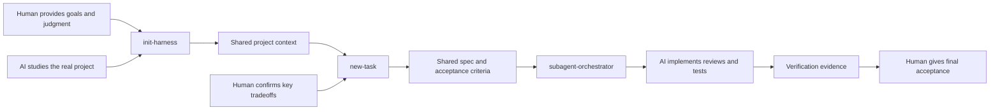

# Codex Harness Workflow

> Humans own direction and judgment. AI organizes, executes, and shows its evidence.

This is a Codex-first **human-AI collaboration workflow for software development**. It does not ask AI to take over the project, and it does not ask a human to micromanage every line. It gives both sides a shared understanding of **what they are building, which decisions require human approval, where AI may act, and what evidence is required before the work is complete**.

[简体中文](README.zh-CN.md)

> **Status: v0.1.0 Beta candidate.** The three skills come from real project use; one complete reproducible release regression remains open.

## Project origin

Codex Harness Workflow was originally designed and is maintained by
[weiqiang612](https://github.com/weiqiang612). This repository is the official source:
[github.com/weiqiang612/codex-harness-workflow](https://github.com/weiqiang612/codex-harness-workflow).

The code, skills, templates, and associated documentation are available under the
[MIT License](LICENSE), which requires applicable copyright and license notices to be preserved.
Unless the original author explicitly states otherwise, modified versions are not official
releases of this project and are not endorsed by the original author.

## The one-minute story: why humans and AI need a shared agreement

Imagine asking AI:

> Add order refunds to an existing system, including customer requests, manager approval, and a visible refund result.

### Ordinary chat-based collaboration

The developer knows the business and AI can write code, but they do not begin with the same information:

1. The human says “add refunds” and assumes the existing order rules are understood.
2. AI avoids interrupting and guesses who can refund and which states are allowed.
3. The human sees the page and discovers that the guessed behavior is not the real business rule.
4. Frontend and backend agents make different guesses about fields and states.
5. AI reports “done,” but the human cannot tell whether permissions, duplicate refunds, and rollback were verified.
6. A new session begins, and both sides must reconstruct decisions from old chat messages.

Neither side is the problem. The missing pieces are **shared context, explicit decision handoffs, and evidence for completion**.

### With this human-AI collaboration workflow

The same request becomes three clear collaboration handoffs:

1. **Understand the project together:** with `init-harness`, AI studies the real code while the human supplies the goal and corrects business assumptions. Both get the same project map.
2. **Define the feature together:** `new-task` puts ambiguity on the table. The human decides permissions, rules, and tradeoffs; AI records that agreement as a specification, acceptance criteria, and tasks.
3. **Implement and accept together:** `subagent-orchestrator` coordinates implementation, review, and tests inside approved boundaries. The human keeps authority over major decisions and gives final acceptance from visible evidence.

The result is not merely “code written by AI.” The human and AI become a team whose work can be handed off and reviewed:

- the human can see what AI is relying on;
- AI knows what it may decide and when it must ask;
- frontend, backend, and tests share one approved contract;
- completion comes from inspectable evidence, not an AI declaration;
- a new session or agent can continue from shared project files.

## How the three skills divide the work

| Skill | The human owns | AI handles | They leave together |
| --- | --- | --- | --- |
| `init-harness` | Explain the goal, correct business understanding, confirm important constraints | Read code and configuration; organize existing requirements, architecture, database, API, and UI | A project map readable by both human and AI |
| `new-task` | Decide important scope, permission, data, and experience tradeoffs | Surface ambiguity, analyze impact, draft the specification, and split the work | A feature contract approved by both sides |
| `subagent-orchestrator` | Retain authority over major choices and acceptance that needs human judgment | Coordinate bounded implementation, review, tests, and repair | Code, verification evidence, and an honest completion state |

Together they form one loop:



## Five common human-AI collaboration scenarios

### 1. The human says “that project,” and AI opens the wrong folder

**Collaboration failure:** the human knows their machine and casually says “change the existing project.” AI sees two similar folders and has to guess. Both may discover the mistake much later.

**Handled by:** `init-harness`

**Afterward:** AI uses real Maven, Gradle, npm, or other manifests to find the runnable project, then presents modules, ports, and commands for human confirmation. “This project” now means the same facts to both sides.

**Inspectable result:** root/module `AGENTS.md`, real build commands, and scanned API/database context.

### 2. The human says little, and AI assumes too much

**Collaboration failure:** “add refunds” carries unstated human context. To keep moving, AI fills in who may refund, how many times, and what rollback means. Both sides believe the request was clear.

**Handled by:** `new-task`

**Afterward:** AI explains why each ambiguity matters. It handles routine technical choices, while the human confirms choices that change business behavior, security, data, APIs, or acceptance. Only then is the agreement written into `spec.md` and `tasks.md`.

**Inspectable result:** scope, non-goals, key decisions, 3–6 executable acceptance criteria, and tasks mapped to each criterion.

### 3. The human approved one requirement, but different agents read it differently

**Collaboration failure:** frontend fields, backend responses, database facts, and UI states drift until integration.

**Handled by:** `new-task` + `subagent-orchestrator`

**Afterward:** AI turns the request into shared API, database, architecture, and UI contracts, with important changes confirmed by the human. Frontend, backend, and test agents then work from that contract instead of separately translating the original sentence.

**Inspectable result:** contract tasks precede implementation, and frontend/backend/tests reference the same acceptance criteria.

### 4. The human asks several agents for help and becomes the integration firefighter

**Collaboration failure:** frontend, backend, and tests are assigned without dependencies or write boundaries. Two agents edit the same file, or each assumes another will add tests, leaving the human to stitch everything together.

**Handled by:** `subagent-orchestrator`

**Afterward:** the orchestrating agent builds a visible dependency graph and bounded assignments. Only independent work with disjoint write sets runs in parallel. Cross-module decisions return to the human instead of being guessed differently by each agent.

**Inspectable result:** scoped agent briefs, changed-file handoffs, test results, and integration review.

### 5. AI says “done,” and the human does not know whether to trust it

**Collaboration failure:** AI treats “code generated” as “requirement complete.” The human gets a summary but cannot see whether tests, browser flows, responsive behavior, and failure paths were actually checked.

**Handled by:** `subagent-orchestrator`

**Afterward:** AI submits separate evidence for code, automated tests, frontend builds, and browser acceptance. Business feel and visual judgment remain with the human. No evidence means no passing state.

**Inspectable result:** `passes` values, unchecked tasks, logs, screenshots, and explicit remaining blockers.

## How it maps to traditional software development

This workflow does not replace software engineering. It adds explicit human-AI handoffs to familiar stages. AI can take on more preparation and execution, while product responsibility, important tradeoffs, and final acceptance remain human-owned.

| Traditional stage | Human role | AI role | Shared artifact |
| --- | --- | --- | --- |
| Project discovery and requirements | Explain goals, business context, and real constraints | Read existing code and organize unknowns | Confirmed project baseline |
| Architecture, database, API, and UI/UX design | Own important product and technical tradeoffs | Summarize reality, analyze impact, and draft designs | Long-lived design and decision records |
| Feature review | Answer questions that change business outcomes | Surface ambiguity, impact, and options | Scope, non-goals, and confirmed choices |
| Work breakdown and Definition of Done | Confirm priorities and completion criteria | Generate acceptance criteria and dependency-aware tasks | Executable feature plan |
| Frontend/backend development | Resolve escalated decisions and necessary interventions | Implement, test, and hand off within write boundaries | Reviewable code and test results |
| Code review, integration, and acceptance | Judge whether behavior, experience, and risk are acceptable | Provide independent review and automated/UI evidence | A completion decision both sides can inspect |

See [workflow architecture](docs/architecture.md) for the artifact contracts passed between stages.

## Evidence from real use

The workflow has been used on a fully anonymized Java/Spring Boot, Vue/TypeScript, and MySQL environmental-monitoring application.

- `init-harness` created stable locations for requirements, architecture, database, API, UI, constraints, ADRs, and feature tasks.
- One field-measurement feature entered `new-task` and produced **6 acceptance criteria** and **16 ordered tasks** without changing business code or the database during task creation.
- A completed management workflow recorded **23 passing backend tests** plus successful frontend build and lint gates.
- One UI acceptance run could not start its browser connection, so that gate remained incomplete instead of being presented as passed.

This proves that the workflow produced traceable and reviewable artifacts. It is not a productivity benchmark, and no speed or defect-reduction percentage is claimed without reliable before/after data.

Read the [anonymized case study](docs/case-study-environmental-monitoring.md) or inspect the [sanitized evidence bundle](examples/environmental-monitoring/).

## Why it was designed this way

These skills grew from studying Vibe Coding, spec-driven development, long-running agent harnesses, and then applying those ideas to real projects. They share one premise: **good AI Coding does not remove the human from the loop; it brings human judgment and AI execution together at the right moments.**

- **Keep the flow of Vibe Coding:** humans express intent while AI performs substantial exploration, implementation, and verification.
- **Adopt the SDD sequence:** `Spec → Plan → Tasks → Implement` prevents a vague request from becoming code immediately.
- **Make decision authority explicit:** AI proceeds on low-risk technical details; choices affecting business behavior, permissions, data, or acceptance return to the human.
- **Use black-box acceptance:** criteria say what action to perform and what result must be observed.
- **Make long tasks resumable:** project and feature state live in files that a new session can read.
- **Disclose context progressively:** `AGENTS.md` stays a short index while detailed requirements, designs, and constraints are loaded when relevant.
- **Use the Harness as shared memory:** humans do not need to repeat everything and AI does not depend on short-lived chat history; skipped steps become gates and conflict-prone changes gain write boundaries.

Primary influences:

- [Thoughtworks: Spec-driven development](https://www.thoughtworks.com/en-gb/insights/blog/agile-engineering-practices/spec-driven-development-unpacking-2025-new-engineering-practices)
- [GitHub Spec Kit](https://github.github.com/spec-kit/index.html)
- [Anthropic: Effective harnesses for long-running agents](https://www.anthropic.com/engineering/effective-harnesses-for-long-running-agents)
- [Anthropic: Harness design for long-running application development](https://www.anthropic.com/engineering/harness-design-long-running-apps)
- [Agents.md Guide for Java and Spring Boot Developers](https://josealopez.dev/en/blog/agents-md-java-spring-boot)

The task lifecycle is A2A-inspired, but this repository does not implement or claim compliance with the standard A2A protocol.

## When to use it

Good fit:

- an existing codebase;
- a feature that touches frontend, backend, APIs, or data together;
- medium-sized or complex work that benefits from multiple agents;
- work that needs review, test, and acceptance evidence.

Probably too heavy:

- fixing one typo;
- a tiny local refactor with no behavioral or contract impact;
- a disposable experiment with no maintenance needs.

v0.1.0 focuses on medium-sized and complex changes. A lightweight path is planned for a later version.

## Repository contents

| Path | Contents |
| --- | --- |
| [`skills/init-harness`](skills/init-harness/) | Project-map generation skill |
| [`skills/new-task`](skills/new-task/) | Feature specification and task-generation skill |
| [`skills/subagent-orchestrator`](skills/subagent-orchestrator/) | Multi-agent implementation, review, and acceptance skill |
| [`docs`](docs/) | Architecture, portability, case study, and release checklist |
| [`examples/environmental-monitoring`](examples/environmental-monitoring/) | Sanitized evidence from real use |
| [`examples/minimal-task-board`](examples/minimal-task-board/) | Dependency-free fixture for reproducing the three-step workflow |
| [`scripts/verify.ps1`](scripts/verify.ps1) | Structure, link, privacy, and release checks |

## Install and use

Copy the three directories under `skills/` into the Codex Skill directory, restart Codex, then use
`init-harness`, `new-task`, and `subagent-orchestrator` in sequence. See the
[installation guide](docs/installation.md) for Windows, macOS/Linux, standards-source overrides,
and browser selection examples.

See the [changelog](CHANGELOG.md) and the
[v0.1.0-beta release notes](docs/releases/v0.1.0-beta.md) for the current release scope.

## Contributor quick start

Run the base checks:

```powershell
pwsh -File .\scripts\verify.ps1
```

Run strict release checks:

```powershell
pwsh -File .\scripts\verify.ps1 -Release
```

Before release, also perform the [minimal release smoke test](docs/release-smoke-test.md) and review
the [release checklist](docs/release-checklist.md).

## Current boundaries

- Codex is currently the only fully supported reference implementation.
- Other coding agents need adapters for project instructions, lifecycle hooks, browser capabilities, and subagent collaboration; see [portability](docs/portability.md).
- This project uses the MIT License; the license does not imply endorsement of modified versions.
