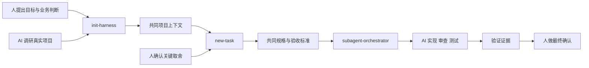

# Codex Harness Workflow

> 让人负责方向与判断，让 AI 负责整理、执行与举证。

这是一套面向 Codex 的**人机协作式 AI Coding 工作流**。它不是让 AI 接管项目，也不是让人逐行指挥 AI。它帮助人和 AI 建立一份共同理解：**我们要做什么、哪些决定必须由人确认、AI 可以在哪些边界内行动，以及怎样才算真的完成。**

[English](README.md)

> **当前状态：v0.1.0 Beta 候选。** 三个 Skill 来自真实项目实践；一次完整的可复现发布回归仍待完成。

## 项目来源

Codex Harness Workflow 由 [weiqiang612](https://github.com/weiqiang612) 原始设计并维护。
本仓库是项目的官方来源：
[github.com/weiqiang612/codex-harness-workflow](https://github.com/weiqiang612/codex-harness-workflow)。

代码、Skill、模板和相关文档采用 [MIT License](LICENSE)，适用的版权和许可证声明需要保留。
除非原作者另行明确说明，修改版不是本项目的官方版本，也不代表获得原作者背书。

## 一分钟看懂：人和 AI 为什么需要一份共同约定

假设你对 AI 说：

> 给现有系统增加一个“订单退款”功能，要有用户申请、管理员审核和退款结果展示。

### 普通聊天式协作

开发者知道业务背景，AI 擅长写代码，但两边掌握的信息并不相同：

1. 人说“增加退款”，以为现有订单规则 AI 已经知道；
2. AI 不想打断工作，于是自己猜测谁能退款、哪些状态可以退款；
3. 人看到页面后才发现，AI 的理解和真正的业务规则不一样；
4. 前端 Agent、后端 Agent 又分别猜出不同的字段和状态；
5. AI 汇报“完成”，人却不知道权限、重复退款和失败回滚是否真的验证过；
6. 换一个新会话，双方还要重新解释之前谈过的决定。

问题不在于人或 AI 不够聪明，而在于双方之间缺少**共同上下文、决策交接和完成证据**。

### 使用这套人机协作工作流

同一个需求变成三次清楚的协作交接：

1. **共同认识项目：** `init-harness` 让 AI 调研真实代码，人补充业务目标并确认关键事实，双方得到同一张项目地图。
2. **共同定义功能：** `new-task` 让 AI 把模糊点摆到桌面上；人决定权限、规则和取舍，AI 再把共识写成规格、验收标准和任务。
3. **共同完成并验收：** `subagent-orchestrator` 让 AI 在约定边界内组织实现、审查和测试；人保留重大决策权，并根据证据做最终确认。

结果不是“AI 替人写了一些代码”，而是人与 AI 真正组成一个可以交接、可以复查的开发团队：

- 人知道 AI 正在依据什么工作；
- AI 知道哪些事情可以自行处理，哪些必须停下来询问；
- 前端、后端和测试共享同一份已确认契约；
- “完成”由可检查的证据决定，而不是由 AI 单方面宣布；
- 新会话和新 Agent 可以接着共同文件继续协作。

## 三个 Skill 如何分配人与 AI 的工作

| Skill | 人负责什么 | AI 负责什么 | 双方共同留下什么 |
| --- | --- | --- | --- |
| `init-harness` | 说明项目目标，纠正业务理解，确认重要约束 | 阅读代码与配置，整理已有需求、架构、数据库、API 和 UI | 一份人和 AI 都能读取的项目地图 |
| `new-task` | 决定业务范围、权限、数据与体验上的重要取舍 | 发现模糊点、分析影响、起草规格并拆分任务 | 一份双方确认过的功能契约 |
| `subagent-orchestrator` | 保留重大决策权，处理需要人工判断的验收 | 安排有边界的实现、审查、测试和修复 | 代码、验证证据以及诚实的完成状态 |

三个 Skill 可以单独使用，但连起来才是完整闭环：



## 五个常见的人机协作场景

### 场景一：人说“就是那个项目”，AI 却进错了目录

**协作出了什么问题：** 人熟悉自己的电脑，所以只说“在原来的项目里改”；AI 看见两个相似目录，只能猜。猜错之后，双方还可能很晚才发现。

**谁来处理：** `init-harness`

**有它之后：** AI 先用 Maven、Gradle、npm 等真实清单找出可运行项目，再把识别到的模块、端口和命令交给人确认。以后双方说“这个项目”时，指向的是同一组事实。

**可以检查的结果：** 根目录与子模块 `AGENTS.md`、真实构建命令、接口与数据库基线。

### 场景二：人说得很短，AI 理解得太满

**协作出了什么问题：** 人只说“增加退款”，心里还带着很多默认常识；AI 为了继续工作，补出了谁能退、能退几次、失败是否回滚等答案。双方都以为自己表达清楚了。

**谁来处理：** `new-task`

**有它之后：** AI 不只是提问，而是说明每个模糊点会影响什么。普通技术细节由 AI 处理；会改变业务、权限、数据、API 或验收结果的选择由人确认。确认后，共识才写入 `spec.md` 和 `tasks.md`。

**可以检查的结果：** 功能范围、明确不做什么、关键决策、3–6 条可执行验收标准，以及每条标准对应的任务。

### 场景三：人已经确认需求，不同 Agent 却各自理解

**协作出了什么问题：** 前端先写了一套字段，后端又实现了另一套；数据库字段、接口文档和页面状态互相对不上，最后都在联调阶段返工。

**谁来处理：** `new-task` + `subagent-orchestrator`

**有它之后：** AI 先把需求转成 API、数据库、架构和 UI 的共同契约，人确认其中的重要变化。前端、后端和测试 Agent 随后都从这份契约领取工作，不再各自翻译人的原话。

**可以检查的结果：** 契约任务排在实现任务之前，前端、后端和测试引用相同的验收标准。

### 场景四：人想让多个 Agent 帮忙，却变成自己到处救火

**协作出了什么问题：** 人把前端、后端和测试分别交给多个 Agent，但没有说明依赖关系和写入范围。两个 Agent 修改同一文件，或者都以为另一个会补测试，最后由人手工拼接结果。

**谁来处理：** `subagent-orchestrator`

**有它之后：** 编排 Agent 先画依赖图，并把分工展示为可检查的任务。只有互不依赖、写入范围不重叠的工作才并行；碰到跨模块决策时回到人，而不是让多个 Agent 分别猜测。

**可以检查的结果：** 有边界的 Agent 任务说明、修改文件清单、测试结果和集成审查。

### 场景五：AI 说“完成了”，人不知道该不该相信

**协作出了什么问题：** AI 把“代码已经生成”当成“需求已经完成”；人只收到一句总结，看不到单元测试、浏览器、移动端和异常路径究竟检查了没有。

**谁来处理：** `subagent-orchestrator`

**有它之后：** AI 分别提交代码、自动测试、前端构建和浏览器验收证据；需要业务感受或视觉判断的部分留给人确认。哪一项没有证据，哪一项就保持未完成。

**可以检查的结果：** `passes` 状态、未勾选任务、测试日志、构建结果、截图和明确的剩余阻塞项。

## 它和传统软件开发是什么关系

这套工作流没有抛弃传统软件工程，而是给传统流程增加了清楚的人机交接点。AI 可以承担更多准备与执行工作，但产品责任、关键取舍和最终认可仍然由人掌握。

| 传统研发阶段 | 人的角色 | AI 的角色 | 协作产物 |
| --- | --- | --- | --- |
| 项目调研、需求分析 | 说明目标、业务背景与真实限制 | 阅读现有代码并整理未知项 | 已确认的项目基线 |
| 架构、数据库、API、UI/UX 设计 | 决定重要取舍并承担产品与技术责任 | 汇总现状、分析影响、起草设计 | 长期设计文档和决策记录 |
| 功能需求评审 | 回答会改变业务结果的关键问题 | 发现歧义、列出影响和备选方案 | 范围、非目标与已确认选择 |
| 任务拆分、完成定义 | 确认优先级和完成标准 | 生成验收标准与依赖明确的任务 | 可执行的功能计划 |
| 前后端开发 | 处理升级决策与必要人工介入 | 在写入边界内实现、测试和交接 | 可审查的代码与测试结果 |
| Code Review、联调与验收 | 判断业务、体验和风险是否可接受 | 提供独立审查与自动化、页面证据 | 双方都能核对的完成结论 |

更完整的产物关系见[工作流架构](docs/architecture.md)。

## 一次真实使用留下了什么

这套工作流已经用于一个完全脱敏的 Java/Spring Boot、Vue/TypeScript 和 MySQL 环保监测全栈项目。

- `init-harness` 为已有代码建立了需求、架构、数据库、API、UI、约束、ADR 和任务目录。
- 一个现场检测功能通过 `new-task` 生成了 **6 条验收标准**和 **16 项有顺序的任务**；创建任务时没有修改业务代码或数据库。
- 一个已完成的管理流程留下了 **23 项后端测试通过**以及前端构建、Lint 通过的记录。
- 某次 UI 验收因为浏览器连接失败没有执行，所以它保持未完成，没有被包装成“已经通过”。

这些结果证明工作流确实留下了可追踪、可复核的工程产物，但它们不是效率 Benchmark。因为没有可靠的前后对照，我们不声称“速度提升多少”或“缺陷减少多少”。

你可以阅读[完整脱敏案例](docs/case-study-environmental-monitoring.md)，或者直接检查[脱敏证据包](examples/environmental-monitoring/)。

## 为什么会这样设计

这三个 Skill 来自对 Vibe Coding、规格驱动开发和长任务 Agent Harness 的学习与真实项目实践。它们的共同出发点是：**好的 AI Coding 不是把人移出流程，而是让人的判断和 AI 的执行在正确时机相遇。**

- **保留 Vibe Coding 的流畅感：** 人表达意图，AI 承担大量探索、实现和验证工作。
- **吸收 SDD 的顺序：** 从 `Spec → Plan → Tasks → Implement` 出发，避免模糊需求直接变成代码。
- **明确决策权：** 低风险技术细节让 AI 继续推进；影响业务、权限、数据和验收的选择回到人。
- **采用黑盒验收：** 验收标准描述“执行什么动作、应该看到什么结果”，而不只是“代码看起来正确”。
- **支持长任务继续工作：** 项目状态和功能状态写入文件，新会话能够继续读取。
- **渐进式披露上下文：** `AGENTS.md` 保持为短入口，详细需求、设计和约束按需读取。
- **用 Harness 形成共同记忆：** 人不必反复解释，AI 也不必依赖短暂聊天记录；容易跳过的步骤变成门禁，容易冲突的修改增加写入边界。

主要参考：

- [Thoughtworks：Spec-driven development](https://www.thoughtworks.com/en-gb/insights/blog/agile-engineering-practices/spec-driven-development-unpacking-2025-new-engineering-practices)
- [GitHub Spec Kit：Spec-driven development toolkit](https://github.github.com/spec-kit/index.html)
- [Anthropic：Effective harnesses for long-running agents](https://www.anthropic.com/engineering/effective-harnesses-for-long-running-agents)
- [Anthropic：Harness design for long-running application development](https://www.anthropic.com/engineering/harness-design-long-running-apps)
- [Agents.md Guide for Java and Spring Boot Developers](https://josealopez.dev/en/blog/agents-md-java-spring-boot)

任务生命周期借鉴了 A2A 的任务化通信思想，但本仓库没有实现或宣称符合标准 A2A 协议。

## 什么时候适合使用

适合：

- 已经有代码的项目；
- 需要同时修改前端、后端、数据库或接口的功能；
- 需要多个 Agent 协作的中型和复杂任务；
- 需要保留评审、测试和验收证据的工作。

可能太重：

- 修改一个错别字；
- 不改变行为的几行本地代码；
- 一次性、无需长期维护的小实验。

v0.1.0 先服务中型和复杂变更，轻量模式计划在后续版本设计。

## 仓库内容

| 位置 | 内容 |
| --- | --- |
| [`skills/init-harness`](skills/init-harness/) | 项目地图生成 Skill |
| [`skills/new-task`](skills/new-task/) | 功能规格和任务生成 Skill |
| [`skills/subagent-orchestrator`](skills/subagent-orchestrator/) | 多 Agent 实施、审查和验收 Skill |
| [`docs`](docs/) | 架构、兼容性、案例与发布清单 |
| [`examples/environmental-monitoring`](examples/environmental-monitoring/) | 真实实践的脱敏证据 |
| [`examples/minimal-task-board`](examples/minimal-task-board/) | 零依赖、可复制的三步工作流回归项目 |
| [`scripts/verify.ps1`](scripts/verify.ps1) | 结构、链接、隐私和发布检查 |

## 安装和使用

将 `skills/` 下的三个 Skill 目录复制到 Codex Skill 目录，重启 Codex，然后依次使用
`init-harness`、`new-task` 和 `subagent-orchestrator`。Windows、macOS/Linux 命令、默认规则源
覆盖方式和浏览器选择示例见[安装说明](docs/installation.md)。

发布变化见 [CHANGELOG](CHANGELOG.md)，当前 Beta 范围见
[v0.1.0-beta Release Notes](docs/releases/v0.1.0-beta.md)。

## 贡献者快速开始

运行基础检查：

```powershell
pwsh -File .\scripts\verify.ps1
```

运行严格发布检查：

```powershell
pwsh -File .\scripts\verify.ps1 -Release
```

发布前还应执行[最小发布回归](docs/release-smoke-test.md)，并核对
[发布清单](docs/release-checklist.md)。

## 当前边界

- Codex 是目前唯一完整支持的参考实现。
- 其他 Coding Agent 需要适配项目指令、生命周期 Hook、浏览器和子 Agent 协作能力，详见[跨 Agent 适配说明](docs/portability.md)。
- 本项目采用 MIT License；许可证不代表原作者对修改版本提供背书。
