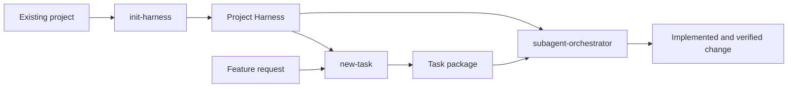

# Workflow architecture

## Goal

Turn an existing software repository and a natural-language feature request into a constrained, reviewable, and verifiable delivery process.

## Contracts between skills

### Project Harness

`init-harness` produces the long-lived project context consumed by later skills:

- root and submodule `AGENTS.md` files
- project requirements and design contracts
- permanent safety and approval constraints
- current-plan and feature-task directories
- lightweight Codex session-start context

### Task package

`new-task` produces a task directory containing:

- `spec.md` with scope, assumptions, and acceptance criteria
- `tasks.md` with ordered work and verification gates
- a minimal update to `docs/4-tasks/CURRENT_PLAN.md`

Shared API, database, architecture, UI, or operational contracts are updated before dependent implementation work.

### Verified delivery

`subagent-orchestrator` reads the project Harness and task package, builds a dependency graph, assigns disjoint work, independently reviews changes, runs acceptance checks, and updates task state only when supported by current evidence.

## Source-of-truth policy

- During initial repository assembly, the imported content is copied from the maintained local `.agents/skills` versions.
- Files under this repository's `skills/` directory are release candidates and must be reviewed before publishing.
- Machine-specific mirror tooling and absolute local paths are not distributable repository content.
- Before v0.1.0, the repository must become the distribution source of truth and installation must copy from the repository into agent-specific locations.

## Non-goals for v0.1.0

- implementing the standard A2A protocol
- providing a general-purpose agent runtime
- claiming identical behavior across every coding agent
- hiding unavailable browser, collaboration, or lifecycle capabilities behind silent fallbacks
